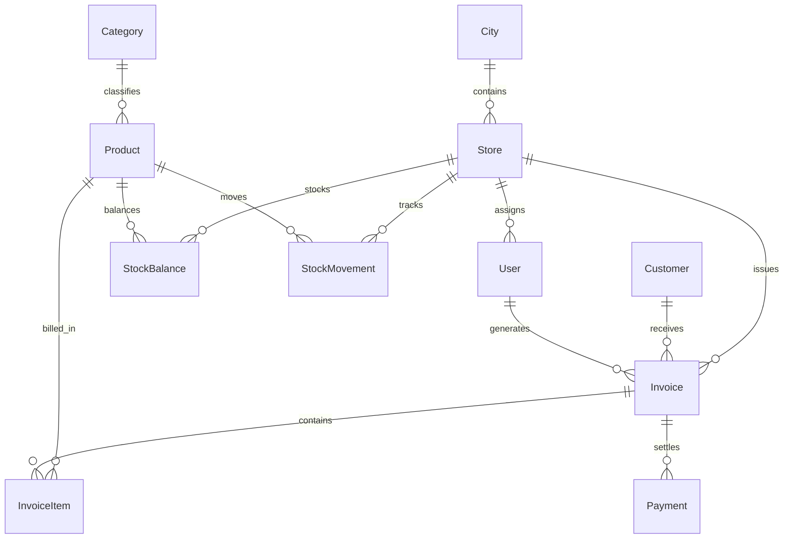

# J I PERFUME ERP — Project Structure & Functionality Documentation

> **System Name:** J I PERFUME Luxury Retail & Fragrance Chain ERP  
> **Architecture:** Decoupled Client-Server (React.js + Node.js / Express + Prisma ORM + MySQL)  
> **Target Industry:** Luxury Perfumery, High-End Fragrance Retail, Boutique Outlets & POS Counter Operations  
> **Last Updated:** November 2026

---

## Table of Contents

1. [Executive Overview](#1-executive-overview)
2. [Technology Stack](#2-technology-stack)
3. [Complete Project Directory Structure](#3-complete-project-directory-structure)
4. [Database Architecture & Data Models](#4-database-architecture--data-models)
5. [Core Business Functionalities & Workflows](#5-core-business-functionalities--workflows)
   - [5.1 Point of Sale (POS) Counter Operations](#51-point-of-sale-pos-counter-operations)
   - [5.2 Dynamic UPI QR Payments (NPCI Standard)](#52-dynamic-upi-qr-payments-npci-standard)
   - [5.3 WhatsApp Automated Invoicing (Meta Cloud API)](#53-whatsapp-automated-invoicing-meta-cloud-api)
   - [5.4 Invoices & Receipts Management](#54-invoices--receipts-management)
   - [5.5 Product Master & Fragrance Vault](#55-product-master--fragrance-vault)
   - [5.6 Store-Wise Stock Management](#56-store-wise-stock-management)
   - [5.7 Category Master (Olfactive Taxonomy)](#57-category-master-olfactive-taxonomy)
   - [5.8 Outlet & Store Master](#58-outlet--store-master)
   - [5.9 Users & Staff Master](#59-users--staff-master)
   - [5.10 Roles & Permissions Capability Matrix](#510-roles--permissions-capability-matrix)
   - [5.11 PDF Invoices & POS Thermal Receipts Engine](#511-pdf-invoices--pos-thermal-receipts-engine)
6. [Authentication, Security & Route Protection](#6-authentication-security--route-protection)
7. [REST API Endpoints Specification](#7-rest-api-endpoints-specification)
8. [Setup, Deployment & Environment Configuration](#8-setup-deployment--environment-configuration)

---

## 1. Executive Overview

**J I PERFUME ERP** is a centralized, multi-location enterprise resource planning system tailored specifically for luxury fragrance houses, multi-city boutique counters, and high-volume retail POS operations.

The application unifies counter sales, dynamic UPI QR collections, automated WhatsApp PDF bill dispatches, store-wise inventory balances, stock movements, staff assignments, and fine-grained capability matrix permissions into a cohesive, responsive web platform.

---

## 2. Technology Stack

### Frontend Architecture
- **Framework:** React 18 (Vite build engine)
- **Routing:** React Router v6 (declarative client routes, role guards, and 403 fallbacks)
- **Styling:** Tailwind CSS (Light Luxury boutique theme with slate neutrals and amber accents)
- **Icons:** Lucide React
- **State & Context:** React Context API (`CartContext`, `ThemeContext`) + LocalStorage caching
- **HTTP Client:** Axios (configured with credentials, automatic token interceptors, and baseURL resolvers)

### Backend Architecture
- **Runtime:** Node.js (ES Modules `import/export`)
- **Web Framework:** Express.js 4
- **ORM / Database Layer:** Prisma ORM 5 with raw SQL capabilities
- **Database Engine:** MySQL 8.x / MariaDB
- **Authentication & Cryptography:** JSON Web Tokens (`jsonwebtoken`), `bcryptjs`
- **Document Generation:** `pdfkit` (custom luxury vector layout, table rendering, embedded QR codes)
- **QR Code Generator:** `qrcode` (SVG and base64 canvas data URIs)
- **Messaging Integration:** WhatsApp Cloud API via HTTPS request pipeline
- **Logging & Utilities:** `morgan` HTTP logger, `cookie-parser`, `cors`

---

## 3. Complete Project Directory Structure

```text
ji-perfum-/
├── backend/
│   ├── invoices/                      # Auto-saved local PDF tax invoices
│   ├── prisma/
│   │   ├── migrations/                # Database migration histories
│   │   └── schema.prisma              # Database models, relations, and enums
│   ├── src/
│   │   ├── config/
│   │   │   ├── env.js                 # Environment variable loader
│   │   │   └── prisma.js              # Initialized PrismaClient instance
│   │   ├── middleware/
│   │   │   └── auth.js                # JWT verification, cookie extraction & permission authorization
│   │   ├── modules/
│   │   │   ├── auth/
│   │   │   │   ├── auth.controller.js # Login, logout, getMe, session cookies
│   │   │   │   └── auth.routes.js     # /api/v1/auth routes
│   │   │   ├── billing/
│   │   │   │   ├── billing.controller.js # Invoice creation, listing, cancel, due settlement, PDF
│   │   │   │   └── billing.routes.js     # /api/v1/billing routes
│   │   │   ├── dashboard/
│   │   │   │   ├── dashboard.controller.js # Revenue, sales trends, inventory KPIs, CSV export
│   │   │   │   └── dashboard.routes.js     # /api/v1/dashboard routes
│   │   │   ├── payments/
│   │   │   │   ├── payments.controller.js# Payment logging, QR status checks
│   │   │   │   └── payments.routes.js    # /api/v1/payments routes
│   │   │   ├── products/
│   │   │   │   ├── products.controller.js# Product CRUD, barcode lookup, stock adjustments, categories
│   │   │   │   └── products.routes.js    # /api/v1/products routes
│   │   │   ├── stores/
│   │   │   │   ├── stores.controller.js  # Store & city CRUD, UPI/GSTIN metadata
│   │   │   │   └── stores.routes.js      # /api/v1/stores routes
│   │   │   └── users/
│   │   │       ├── roles.service.js   # Dynamic role permissions schema & defaults
│   │   │       ├── users.controller.js# Staff accounts CRUD, roles matrix CRUD
│   │   │       └── users.routes.js    # /api/v1/users routes
│   │   ├── services/
│   │   │   ├── pdf.service.js         # PDFKit invoice generator (A4 luxury styling)
│   │   │   └── whatsapp.service.js    # Meta WhatsApp API integration & phone sanitizer
│   │   ├── app.js                     # Express app setup, CORS, route mounting, 404/500 handlers
│   │   └── server.js                  # HTTP server listener (port 5000)
│   ├── .env                           # Backend environment variables
│   └── package.json                   # Backend dependencies & scripts
│
├── frontend/
│   ├── public/
│   │   ├── favicon.ico
│   │   └── logo_transparent.png       # Luxury JI Perfume branding emblem
│   ├── src/
│   │   ├── components/
│   │   │   ├── AddOutletModal.jsx     # Modal to register new store outlets
│   │   │   ├── DataTable.jsx          # Reusable sorting, pagination, search table
│   │   │   └── Navbar.jsx             # Top navigation bar for POS and user modules
│   │   ├── context/
│   │   │   ├── CartContext.jsx        # POS cart state, stock validation, discounts, calculations
│   │   │   └── ThemeContext.jsx       # Theme and presentation provider
│   │   ├── data/
│   │   │   └── statesAndCities.json   # Cascading Indian states and major commercial cities
│   │   ├── features/
│   │   │   ├── admin/
│   │   │   │   ├── AdminHeader.jsx    # Admin header with store context, POS jump, profile
│   │   │   │   ├── AdminNavbar.jsx    # Top horizontal tabs for admin masters
│   │   │   │   ├── AdminPanelView.jsx # Tab switcher rendering active admin master
│   │   │   │   ├── AdminSidebar.jsx   # Collapsible left navigation bar for masters
│   │   │   │   └── RolesPermissionsView.jsx # Live interactive capability matrix
│   │   │   ├── auth/
│   │   │   │   ├── ChangePasswordModal.jsx # In-app password update dialog
│   │   │   │   └── LoginModal.jsx          # Dual-mode authentication (Staff vs Admin)
│   │   │   ├── billing/
│   │   │   │   ├── DynamicQrModal.jsx # Popup showing live UPI QR code & verification
│   │   │   │   ├── NewBillModal.jsx   # Slide-over checkout drawer
│   │   │   │   └── PosBillingView.jsx # Main POS grid/list catalog, scanner, quick add
│   │   │   ├── categories/
│   │   │   │   └── CategoriesView.jsx # Scent family taxonomy manager
│   │   │   ├── dashboard/
│   │   │   │   ├── components/        # Recharts visualizers, tables, pickers
│   │   │   │   └── DashboardView.jsx  # Executive analytics & KPI dashboard
│   │   │   ├── invoices/
│   │   │   │   ├── InvoicePrintModal.jsx # Print preview (A4 Tax Invoice & 80mm Thermal)
│   │   │   │   └── InvoicesListView.jsx  # Historical bill registry & due collection
│   │   │   ├── outlets/
│   │   │   │   └── OutletsView.jsx    # Boutique store & city management
│   │   │   ├── products/
│   │   │   │   └── ProductsView.jsx   # Fragrance catalog, stock-in, 5MB image upload
│   │   │   └── users/
│   │   │       └── UsersView.jsx      # Staff credentials & store assignments
│   │   ├── services/
│   │   │   └── api.js                 # Axios API service methods with cookie helpers
│   │   ├── utils/
│   │   │   ├── numberToWords.js       # Indian Currency number-to-words converter
│   │   │   └── permissions.js         # Granular capability checker (`hasPermission`)
│   │   ├── App.jsx                    # Core application router, route guards, initialization
│   │   ├── index.css                  # Tailwind styles and print `@media` rules
│   │   └── main.jsx                   # React root entry point
│   ├── index.html                     # HTML5 shell
│   ├── package.json                   # Frontend dependencies
│   ├── tailwind.config.js             # Styling configuration
│   └── vite.config.js                 # Vite development proxy (`/api` -> `localhost:5000`)
│
├── invoices/                          # Root static invoice export repository
├── .gitignore                         # Git tracking exceptions
├── PROJECT_STRUCTURE_AND_FUNCTIONALITY.md # This documentation
└── README.md                          # Initial project summary
```

---

## 4. Database Architecture & Data Models

The system runs on MySQL managed through Prisma ORM (`backend/prisma/schema.prisma`).



### Key Models

| Model | Purpose | Key Attributes & Relations |
| :--- | :--- | :--- |
| **`City`** | Geographical locations | `name`, `state`, relation to `Store[]` |
| **`Store`** | Boutique outlets | `name`, `code`, `cityId`, `address`, `phone`, `gstin`, `upiId`, `isActive` |
| **`User`** | Staff & administrators | `name`, `email`, `passwordHash`, `role` (enum), `assignedStoreId`, `isActive` |
| **`Category`** | Olfactory families | `name`, `code`, `description`, relation to `Product[]` |
| **`Product`** | Fragrance SKUs | `name`, `sku`, `barcode`, `volumeMl`, `concentration`, `purchaseCost`, `sellingPrice`, `taxRate`, `stockQuantity`, `imageUrl` (LongText), `categoryId` |
| **`StockBalance`** | **Store-wise inventory** | `productId`, `storeId`, `quantity`, `reorderLevel` (Unique: `[productId, storeId]`) |
| **`Customer`** | Client directory | `name`, `phone`, `email`, `city`, `address`, `totalVisits`, `totalSpend` |
| **`Invoice`** | Official bills | `invoiceNumber`, `storeId`, `customerId`, `cashierId`, `subtotal`, `taxAmount`, `discountAmount`, `grandTotal`, `paidAmount`, `dueAmount`, `paymentStatus`, `paymentMethod` |
| **`InvoiceItem`** | Line items | `invoiceId`, `productId`, `productName`, `sku`, `volumeMl`, `unitPrice`, `quantity`, `totalAmount` |
| **`Payment`** | Payment logs | `invoiceId`, `amount`, `method`, `status`, `transactionReference`, `upiString`, `qrDataUrl` |
| **`StockMovement`**| Audit movements | `productId`, `storeId`, `quantityChange`, `type` (`SALE`, `RECEIVE`, `RETURN`, `ADJUST`), `referenceId` |
| **`role_permissions`** | Dynamic matrix table | `role_id` (PK), `name`, `description`, `badge_color`, `permissions` (JSON array of permission keys) |

---

## 5. Core Business Functionalities & Workflows

### 5.1 Point of Sale (POS) Counter Operations
- **Location Context:** Staff members are tied to their designated counter (e.g., *Mandvi Heritage Boutique*). All catalog prices, inventory counts, and invoices strictly enforce the active store context.
- **Barcode & SKU Scanning:** Real-time hardware barcode scanner and manual SKU search bar. Scanning automatically finds the fragrance, validates counter stock, and appends it to the bill.
- **Visual Catalog & Stock Indicators:** Live indicators showing in-stock counter quantities (`20 in Mandvi Heritage Boutique`), low-stock indicators, and chain-wide inventory counts.
- **Checkout Drawer & Discounts:**
  - Add line-item discounts or overall invoice discounts (Percentage `%` or Fixed Amount `₹`).
  - Automatic Indian GST calculation (18% standard, split into 9% CGST + 9% SGST).
- **Split Payment Engine:** Accept multiple tender methods in a single bill:
  - Cash
  - UPI / QR Code
  - Credit Card / Debit Card
  - Customer Credit (Recorded as `DUE_PAYMENT`)

### 5.2 Dynamic UPI QR Payments (NPCI Standard)
- Generates compliant Indian National Payments Corporation (NPCI) UPI strings:
  `upi://pay?pa=<store_upi>&pn=JJ_PERFUME&am=<exact_amount>&cu=INR&tn=Bill_<invoice_number>`
- Renders an ultra-sharp dynamic QR code modal instantly on the counter screen.
- Customers scan with Google Pay, PhonePe, Paytm, or BHIM.
- Cashier confirms credit and generates official thermal/A4 tax invoices.

### 5.3 WhatsApp Automated Invoicing (Meta Cloud API)
- Customer mobile numbers are sanitized to the official 10-digit standard (`sanitizeIndianPhone`).
- Upon bill finalization, the system calls the WhatsApp Business API to dispatch:
  1. A polite luxury greetings notification.
  2. The invoice summary breakdown.
  3. A direct secure download link to the generated PDF Tax Invoice.

#### 5.3.1 Scheduled Low-Stock WhatsApp Cron Job (Multi-Recipient Digest)
- **Background Cron Job:** Operates as a scheduled background worker (`node-cron`) initialized in `backend/src/server.js` and defined in `backend/src/jobs/lowStockCron.js`.
- **Zero Counter Interference:** Does **NOT** spam WhatsApp messages on every individual retail sale or POS billing transaction. Checkouts remain instant and silent.
- **Schedule Configuration:** Configurable via `LOW_STOCK_CRON_SCHEDULE` (default: `0 9 * * *` — every morning at 09:00 AM IST, timezone `Asia/Kolkata`).
- **Store-Wise Grouped Digest:** Scans all physical outlets for inventory $\le 10$ units (or product `reorderLevel`). Aggregates low-stock items into an executive digest grouped by store location (Boutique Name, City, Product Name, SKU, and Remaining Stock).
- **Recipient Configuration:** Dispatches to multiple administrators defined in `LOW_STOCK_ALERT_NUMBERS` in `backend/.env` (e.g. `9904804635, 9725520081`).
- **On-Demand Trigger:** Exposes `POST /api/v1/dashboard/trigger-low-stock-cron` and CLI command `npm run cron:low-stock` for manual audits and verification.

### 5.4 Invoices & Receipts Management
- **Registry (`/invoices`):** Full audit trail of bills filterable by status (`PAID`, `PARTIALLY_PAID`, `PENDING`, `CANCELLED`), date, and outlet.
- **Collect Due Settlement:** Outstanding credit/due balances can be settled at any time with a dedicated payment modal updating remaining due balances.
- **Invoice Cancellation & Reversion:** Authorized managers can cancel invoices, reverting stock deductions in both `StockBalance` and `StockMovement`.

### 5.5 Product Master & Fragrance Vault
- Catalog management supporting SKU, Barcode, Scent Concentration (*Eau de Parfum, Parfum, Eau de Toilette, Attar Oil, Cologne*), Bottle Size (*ml*), Cost, and Selling Price.
- **Image Upload Control (5 MB Limit):**
  - Accepts device uploads up to **5 MB**.
  - Automatically verifies file size and type.
  - Retains **100% original full-fidelity resolution** (no canvas downscaling or blur) for crystal-clear bottle and box presentation.
- Quick Stock In modal for receipt of fresh batches without navigating away from the master.

### 5.6 Store-Wise Stock Management & Stock Inward Workflow
- **Store-Wise Isolation:** Replaces ambiguous "city-wise" allocations with explicit store outlet balances (`Store.id` and `Store.name`).
- Products display independent stock counts for every physical outlet (e.g., *Mandvi Heritage Boutique: 72*, *Ahmedabad Flagship: 20*).
- Initial stock allocation in the Add/Edit Product modal assigns inventory directly to selected store IDs with real-time aggregate calculation.

#### 5.6.1 Stock Inward & Multi-Location Distribution Module (`/admin/inward`)
- **Supply Chain Intake Workflow:** Goods arriving from distilleries, suppliers, or central production are **inwarded first** into the **Central Inward Vault** before retail distribution.
- **Goods Receipt Note (GRN):** Records sequential Inward Consignments (`INW-YYYY-XXXX`) tracking Supplier/Distillery, Delivery Challan / Invoice Ref, Date, and Line Items (Batch #, Inward Quantity, Unit Cost, Total Cost).
- **Central Unallocated Inventory:** Inwarded stock increases `product.unallocatedStock` without prematurely inflating retail store shelves.
- **Multi-Location Distribution (`DST-YYYY-XXXX`):**
  - Managers allocate available inward units across active boutique retail outlets.
  - Validates that allocated units do not exceed available consignment balances.
  - Atomically increments each destination store's `StockBalance`, decrements `product.unallocatedStock`, increments store aggregate `stockQuantity`, updates inward status (`PARTIALLY_DISTRIBUTED` or `FULLY_DISTRIBUTED`), and logs `StockMovement` (type `TRANSFER`).
- **Complete Audit History:** Live log of all inward consignments, pending allocations, and location transfer dispatch slips.

### 5.7 Category Master (Olfactive Taxonomy)
- Structured classification of perfumes into olfactory families: *Floral & Rose, Woody & Amber, Oriental & Oud, Fresh & Aquatic, Gourmand & Vanilla*.
- Displays product count metrics for each family.

### 5.8 Outlet & Store Master
- Register boutique locations across Indian states and cities using `statesAndCities.json`.
- Stores maintain their own business identifiers: Address, Contact Number, Store-Specific UPI ID, and GSTIN.

### 5.9 Users & Staff Master
- Administrative staff creation with email credentials and role tiers:
  - `SUPER_ADMIN` (Owner)
  - `STORE_MANAGER` (Boutique Manager)
  - `CASHIER` (Sales Associate)
  - `VIEWER` (Auditor)
- Staff accounts are assigned to specific store outlets.

### 5.10 Roles & Permissions Capability Matrix
- **Granular Permissions Matrix (`/admin/roles`):** Interactive live matrix allowing owners to grant or revoke specific granular capabilities with a single click:

| Permission Key | Capability Description |
| :--- | :--- |
| `billing:create` | Access POS Counter and generate new bills |
| `billing:settle` | Settle due balances and collect credit payments |
| `billing:discount` | Apply custom percentage or flat bill discounts |
| `invoices:view` | View invoices and customer purchase histories |
| `invoices:cancel` | Cancel bills and revert inventory stock |
| `invoices:print` | Generate A4 Tax Invoices and thermal printouts |
| `invoices:whatsapp` | Send automated WhatsApp invoice notifications |
| `products:view` | Inspect product catalog and inventory balances |
| `products:create` | Add new fragrance SKUs to the master catalog |
| `products:edit` | Modify product prices, descriptions, and stock |
| `products:delete` | Remove fragrance SKUs from system |
| `products:stock` | Receive stock into boutique outlets (Stock In) |
| `categories:view` | Browse scent category taxonomy |
| `categories:manage`| Create, edit, and remove scent categories |
| `stores:view` | View boutique outlets, addresses, and GSTINs |
| `stores:manage` | Register new stores and update outlet parameters |
| `users:view` | View staff accounts and assigned roles |
| `users:manage` | Create and modify staff accounts and credentials |
| `roles:view` | View the security capability matrix |
| `roles:manage` | Modify permissions and create custom role capabilities |

- **Permission Persistence:** Stored in the `role_permissions` database table. Permissions are fetched dynamically during authentication and enforced on both frontend routes and backend APIs.

### 5.11 PDF Invoices & POS Thermal Receipts Engine
- **Luxury A4 Tax Invoice:**
  - Designed with elegant typography and gold header styling.
  - Includes boutique logo, tax breakdown (CGST + SGST), line item tables, UPI payment QR code, and amount in words.
  - Auto-saved locally in `backend/invoices/` and downloadable via secure API.
- **3-Inch 80mm Thermal Receipt:**
  - High-contrast, compact thermal layout tailored for standard ESC/POS 80mm receipt printers.
  - Clean CSS `@media print` rules ensuring clean cutouts with zero margins.

---

## 6. Authentication, Security & Route Protection

### Dual-Token Cookie & Header Security
1. **`token` Cookie:** `httpOnly: true`, preventing client-side script interception (XSS mitigation).
2. **`jj_token` Cookie:** Client-accessible cookie for devtools/state inspection.
3. **`Authorization: Bearer <token>`:** Fallback header supported for mobile apps and third-party integrations.

### Route Protection Architecture
- **Admin Portal (`/admin/*`):** Restricted exclusively to `SUPER_ADMIN` and `STORE_MANAGER`. Unauthenticated or unauthorized staff attempting to access admin routes are intercepted by `AdminRestrictedView`.
- **User / Counter Section:** Cashiers and counter staff navigate via the clean top `Navbar`.
- **Granular Staff Master Access:** If a cashier is granted permissions for Categories, Outlets, or Products, dedicated clean routes ([`/products`](file:///d:/ji-perfum-/frontend/src/App.jsx#L552), [`/categories`](file:///d:/ji-perfum-/frontend/src/App.jsx#L588), [`/outlets`](file:///d:/ji-perfum-/frontend/src/App.jsx#L624)) render those masters within the user interface without displaying the administrative sidebar.
- **403 Access Denied Guard:** Accessing any route without the requisite capability renders a clean `RouteAccessDeniedView` with a return link to the active counter.

---

## 7. REST API Endpoints Specification

All backend routes are prefixed with `/api/v1/`.

### Authentication (`/api/v1/auth`)
| Method | Endpoint | Required Permission | Description |
| :--- | :--- | :--- | :--- |
| `POST` | `/login` | Public | Authenticates credentials and sets session cookies |
| `POST` | `/logout` | Authenticated | Clears session cookies |
| `GET` | `/me` | Authenticated | Returns current authenticated user and permissions |
| `POST` | `/change-password` | Authenticated | Changes password for active user |

### Products & Categories (`/api/v1/products`)
| Method | Endpoint | Required Permission | Description |
| :--- | :--- | :--- | :--- |
| `GET` | `/` | `products:view` | Lists products with store stock, pagination, search |
| `GET` | `/barcode/:code`| `products:view` | Look up fragrance by Barcode or SKU |
| `GET` | `/categories` | `categories:view` | Lists all fragrance scent categories |
| `POST` | `/categories` | `categories:manage` | Creates a new fragrance category |
| `PUT` | `/categories/:id`| `categories:manage` | Updates category metadata |
| `DELETE`| `/categories/:id`| `categories:manage` | Deletes category (verifies zero linked products) |
| `POST` | `/` | `products:create` | Creates SKU (Max 5MB image, store-wise stock) |
| `PUT` | `/:id` | `products:edit` | Updates fragrance details and store balances |
| `DELETE`| `/:id` | `products:delete` | Deletes fragrance SKU |
| `POST` | `/:id/stock` | `products:stock` | Quick Stock In (adds stock to specific store) |

### Billing & Invoices (`/api/v1/billing`)
| Method | Endpoint | Required Permission | Description |
| :--- | :--- | :--- | :--- |
| `POST` | `/` | `billing:create` | Creates invoice, deducts store stock, generates QR |
| `GET` | `/` | `invoices:view` | Lists historical invoices with pagination and filters |
| `GET` | `/:id` | `invoices:view` | Fetches complete invoice with items and payments |
| `GET` | `/:id/pdf` | Public / Link | Streams luxury A4 Tax Invoice PDF |
| `POST` | `/:id/cancel` | `invoices:cancel` | Cancels bill and reverts stock balances |
| `POST` | `/:id/collect-due` | `billing:settle` | Records settlement payment for outstanding due |
| `POST` | `/:id/send-whatsapp`| `invoices:whatsapp`| Manually re-dispatches WhatsApp invoice bill |

### Stores & Outlets (`/api/v1/stores`)
| Method | Endpoint | Required Permission | Description |
| :--- | :--- | :--- | :--- |
| `GET` | `/` | Authenticated | Lists active boutique stores |
| `POST` | `/` | `stores:manage` | Registers new boutique store outlet |
| `PUT` | `/:id` | `stores:manage` | Updates store parameters (UPI, GSTIN, Address) |
| `DELETE`| `/:id` | `stores:manage` | Deactivates or removes store outlet |
| `GET` | `/cities` | Authenticated | Lists registered cities |
| `POST` | `/cities` | `stores:manage` | Registers new city |

### Users & Permissions (`/api/v1/users`)
| Method | Endpoint | Required Permission | Description |
| :--- | :--- | :--- | :--- |
| `GET` | `/` | `users:view` | Lists staff accounts and role assignments |
| `POST` | `/` | `users:manage` | Creates new staff member |
| `PUT` | `/:id` | `users:manage` | Updates staff profile, role, or assigned store |
| `DELETE`| `/:id` | `users:manage` | Deactivates or removes staff user |
| `GET` | `/roles` | `roles:view` | Fetches active permissions for all roles |
| `PUT` | `/roles/:roleId`| `roles:manage` | Updates granular permissions array for a role |
| `POST` | `/roles/permissions` | `roles:manage` | Registers a new custom permission capability |
| `DELETE`| `/roles/permissions/:key` | `roles:manage` | Deletes a custom capability |

### Dashboard Module (`/api/v1/dashboard`)

| Method | Endpoint | Required Permission | Description |
| :--- | :--- | :--- | :--- |
| `GET` | `/summary` | `dashboard:view` | Revenue KPIs, invoice count, AOV, GST, dues, discounts, new customers + % delta |
| `GET` | `/sales-trend` | `dashboard:view` | Daily revenue and invoice count time series |
| `GET` | `/payment-methods` | `dashboard:view` | Instrument split (Cash, UPI QR, Card, Due) with volumes and counts |
| `GET` | `/top-products` | `dashboard:view` | Top 10 bestselling fragrances ranked by revenue and units |
| `GET` | `/category-sales` | `dashboard:view` | Scent family revenue contribution and share percentage |
| `GET` | `/store-performance`| `dashboard:view` (Super Admin) | Chain-wide comparison of revenue, bills, and average ticket |
| `GET` | `/staff-performance`| `dashboard:view` | Sales associate billing volume and gross sales |
| `GET` | `/low-stock` | `dashboard:view` | Inventory items at or below reorder threshold |
| `GET` | `/inventory-value` | `dashboard:view` | Total stock valuation at purchase cost and retail price with margin |
| `GET` | `/recent-invoices` | `dashboard:view` | Latest 10 customer invoices across counters |
| `GET` | `/pending-dues` | `dashboard:view` | Overdue credit invoices sorted by amount and age |
| `GET` | `/recent-activity` | `dashboard:view` | Real-time audit log of stock movements and cancellations |
| `GET` | `/export` | `dashboard:export` | Analytical CSV exports for sales, dues, and low stock |

---

## 8. Setup, Deployment & Environment Configuration

### Prerequisites
- Node.js (v18.x or v20.x+)
- MySQL Server 8.x or MariaDB (via XAMPP, WAMP, or standalone service)
- npm or pnpm

### MySQL Packet Size Requirement
Ensure MySQL allows large payloads (for high-resolution product photos up to 5MB):
1. In your `my.ini` (e.g. `C:\xampp\mysql\bin\my.ini`), verify:
   ```ini
   max_allowed_packet = 64M
   ```
2. Or execute via MySQL client:
   ```sql
   SET GLOBAL max_allowed_packet = 67108864;
   ```

### Backend `.env` Configuration
Path: `backend/.env`
```env
NODE_ENV=development
PORT=5000
FRONTEND_URL=http://localhost:5173

# Database Connection
DATABASE_URL="mysql://root:@localhost:3306/jj_perfume_erp"

# JWT Security
JWT_SECRET=jj_perfume_secure_production_secret_key_2026
JWT_EXPIRES_IN=7d

# WhatsApp Cloud API Integration
WHATSAPP_API=https://crmapi.1automations.com/api/meta
WABA_ID=4085892345045773
PHONE_NUMBER_ID=1267319776475923
BUSINESS_ID=2032478417331763
API_VERSION=v19.0
ACCESS_TOKEN=your_meta_whatsapp_permanent_access_token
WHATSAPP_DOC_TEMPLATE=booking11
WHATSAPP_DOC_LANG=en

# Default Fallback Outlet Data
STORE_NAME="JJ PERFUME"
STORE_UPI_ID="jjperfumes@icici"
STORE_PHONE="+91 98765 43210"
STORE_GSTIN="27AABCJ1234F1Z5"
STORE_ADDRESS="Shop 12, Luxury Galleria, Bandra West, Mumbai 400050"
```

### Installation & Launch Steps

1. **Install Dependencies:**
   ```bash
   # Install Backend
   cd backend
   npm install

   # Install Frontend
   cd ../frontend
   npm install
   ```

2. **Initialize Database:**
   ```bash
   cd backend
   npx prisma db push
   ```

3. **Start Development Servers:**
   ```bash
   # Terminal 1: Backend Server (Port 5000)
   cd backend
   npm run dev

   # Terminal 2: Frontend Server (Port 5173)
   cd frontend
   npm run dev
   ```

4. **Access the System:**
   - **Counter / POS Login:** `http://localhost:5173/login`
   - **Administrative Portal:** `http://localhost:5173/admin/login`
   - **Backend Health Check:** `http://localhost:5000/api/v1/health`
